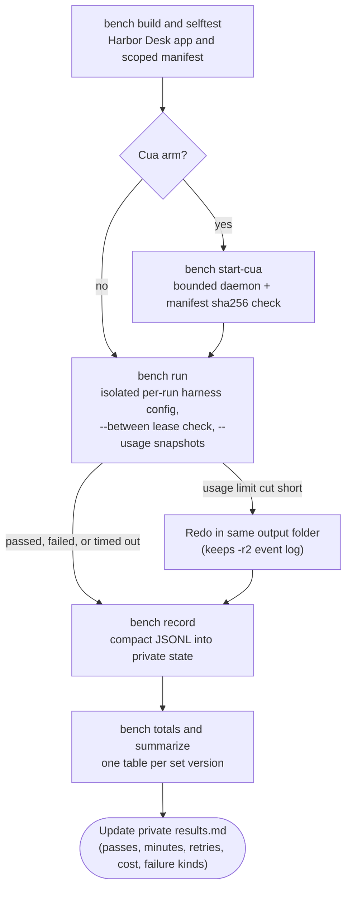

# computer-use-benchmark

How reliable and fast is a computer-use setup on a real macOS desktop? Rather than trusting ad-hoc self-reports across different tasks, every setup runs the same eight seeded GUI tasks in Harbor Desk (`assets/Bench.swift`) and is graded strictly from the app's own event log.

Version and history: [CHANGELOG.md](CHANGELOG.md). Why it works this way: [evidence.md](evidence.md).

## The flow

## What the table says

| Column | What it counts |
| --- | --- |
| Passes | Runs whose final Harbor Desk grade event was `success` out of runs in the set. |
| Minutes | Total wall minutes across the setup's runs. |
| Med s | Median seconds from prompt delivery to `success` across passed runs. |
| Retries | Start-up retries when an agent exited without calling any tool or hitting a limit. |
| Med calls | Median tool calls per run. |
| Med tokens | Median non-cache tokens per run (uncached input, cache writes, and output). |
| Med cache | Median cache-read tokens per run. |
| Failure kinds | Breakdown of failed runs (`post-success-wrong`, `wrong-answer`, `gave-up`, `timeout`, `usage-limit`, `stopped`, `approval-held`, `permission`, `harness-error`, `other`). |

## Where things live

- **This repository:** the skill, `Bench.swift`, `manifest.yaml`, `scripts/bench`, `scripts/tui.py`, and offline tests (`tests/computer-use-benchmark-test`).
- **The private state repository (`computer-use-benchmark/`):** `set.json`, optional `config.json` (user overlays and extra deny servers), compact `runs/<id>/results.jsonl` + `usage.jsonl`, and `results.md`.
- **The cache (`${XDG_CACHE_HOME:-~/.cache}/agent-skills/computer-use-benchmark/`):** compiled `Harbor Desk.app`, copied `manifest.yaml`, and disposable harness workspaces.

## What it doesn't decide

Model and harness routing. The benchmark supplies measured evidence; routing rules change only on the owner's decision through `skill-evolution`.
