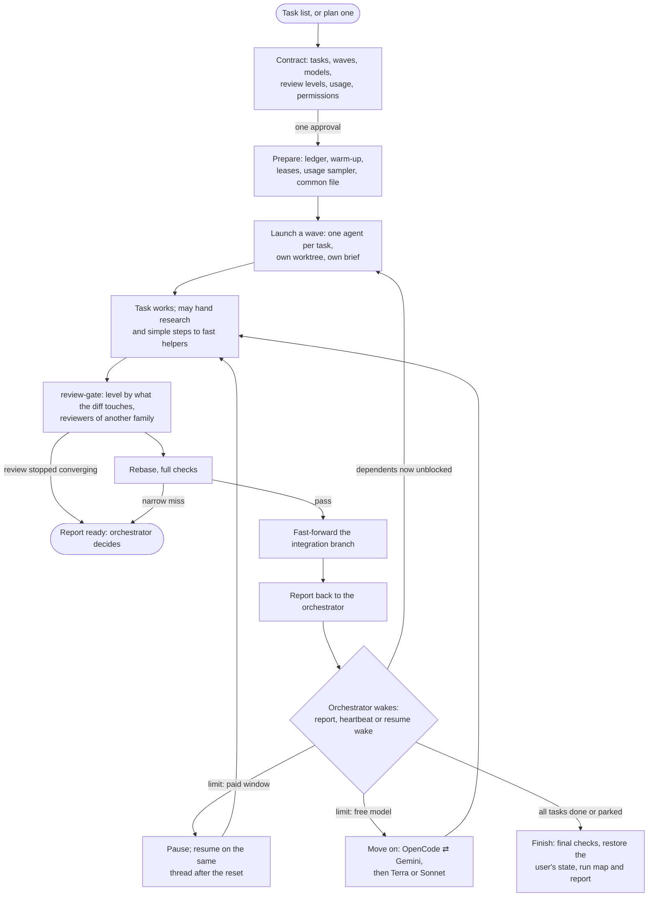

# long-horizon-orchestrator

Runs a set of long agent tasks while the user is away: one approval at the start, each task as its own
agent, reviewed and merged by itself, and a plain-language report at the end. Version and history:
[CHANGELOG.md](CHANGELOG.md).

## A run

## Where the rules are

- `SKILL.md`: the workflow, the contract and what every wake checks.
- `references/routing.md`: which model does what, capacity, limits and the review gate's place.
- `references/task-brief.md`: the brief and the common file every task reads.
- `references/final-report.md`: the report and its charts.
- `references/host-*.md`: launching and waking on T3, Claude Code and Codex.
- `../review-gate`: the review each task passes before it merges.
