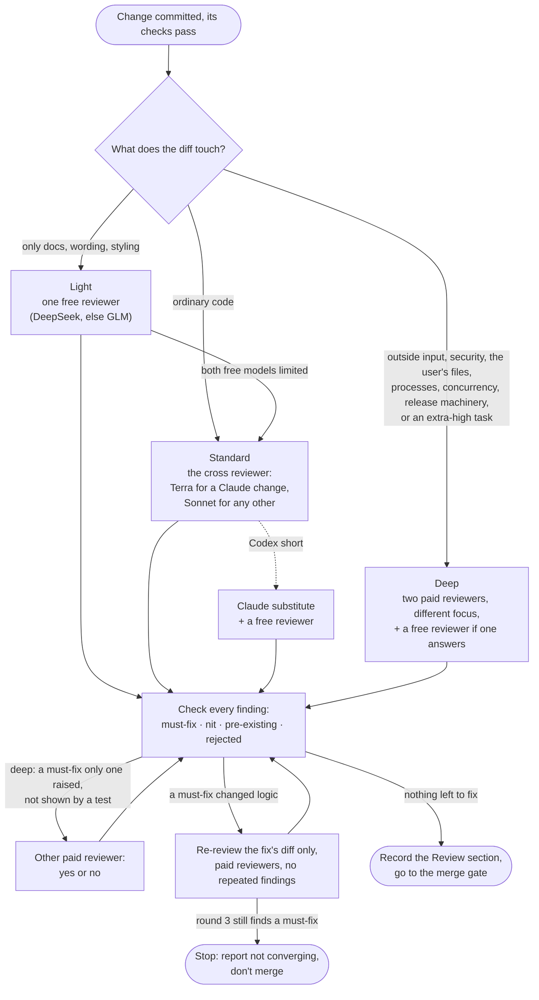

# review-gate

An agent's change merges only after agents that didn't write it have read it. The agent that made the
change runs the gate itself: it picks a level from what the diff touches, launches reviewers of other
model families, checks every finding, fixes what is real and records the result in a fixed format.
The long-horizon orchestrator runs it in every task; a person can also ask for it directly.

Version and history: [CHANGELOG.md](CHANGELOG.md). Why it works this way: [evidence.md](evidence.md).

## The flow



## Who reviews

| Level | Round 1 | Later rounds |
|---|---|---|
| Light | one free reviewer; if both are limited, the cross reviewer | the cross reviewer, only after a logic fix |
| Standard | the cross reviewer (Codex short: its Claude substitute + a free reviewer) | the paid reviewer who found the must-fix |
| Deep | two paid reviewers, different focus, + a free reviewer if one answers | the paid reviewers who found must-fixes |

- **Paid reviewers** run at high reasoning: Codex's GPT-6.1 Terra (preferred to Sol, which costs more of
  the Codex plan), Claude Sonnet 5.5 and Opus 5.5.
- **Codex is preferred but never required:** when it is short, a Claude model other than the change's
  author takes its place, and a free reviewer brings back a second family.
- **Free reviewers** (OpenCode's DeepSeek V4.1 Flash and GLM-5.3 Flash) cost nothing but share one limit
  for the whole computer, which the tasks' research helpers also need. So they review first rounds only,
  and only where they help most for least: alone on light changes, as an extra voice on deep ones, and
  in place of the lost family when Codex is short. They are dropped, never waited for, when limited.
- **Gemini doesn't review:** its reviews were the weakest in past runs.

## The record

Every gate ends with lines like these, which later studies count:

```text
review: level=deep (reads socket input) rounds=2
reviewer=t3/codex gpt-6.1-terra/high rounds=1,2 must-fix=2 nit=3 pre-existing=1 rejected=1 only-one=1
reviewer=t3/claude sonnet-5-5/high rounds=1 must-fix=1 nit=4 pre-existing=0 rejected=2 only-one=0
reviewer=t3/opencode deepseek-v4.1-flash/high skipped=Free usage limit reached
```
