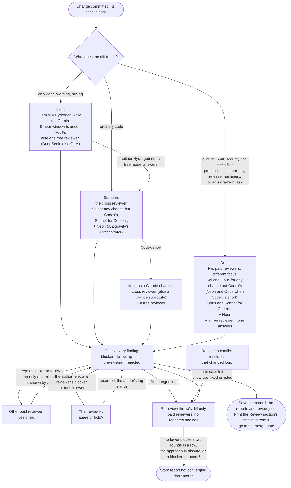

# review-gate

An agent's change merges only after agents that didn't write it have read it. The agent that made the
change runs the gate itself: it picks a level from what the diff touches, launches reviewers of other
model families, checks every finding, fixes what is real and records the result in a fixed format.
The long-horizon orchestrator runs it in every task; a person can also ask for it directly.

Version and history: [CHANGELOG.md](CHANGELOG.md). Why it works this way: [evidence.md](evidence.md).

## The flow

## Who reviews

| Level | Round 1 | Later rounds |
|---|---|---|
| Light | Gemini 4 Hydrogen while the Gemini 5-hour window is under about 60%, else one free reviewer; if none answers, the cross reviewer | the cross reviewer, only after a logic fix |
| Standard | the cross reviewer and Neon (Codex short: Neon as a Claude change's cross reviewer, and a free reviewer); a free reviewer in Neon's place when it can't review | the paid reviewer who found the fixed finding, or the cross reviewer for a fix only Hydrogen or a free reviewer asked for |
| Deep | two paid reviewers, different focus (Sol and Opus for any change but Codex's, or Opus and Sonnet when Codex is short; Opus and Sonnet for Codex's), + Neon and a free reviewer if one answers | the paid reviewers who found the fixed findings |

- **Paid reviewers:** Codex's GPT-6.2 Sol at medium reasoning, and Claude Sonnet 5.5 and Opus 5.5 at high.
  Sol replaced GPT-6.1 Terra in 8.0.0: on the benchmark it found 61 of the 144 defects known before its run
  and 17 of 20 blockers, where Terra found 42 and 9, and none of its findings were false
  ([evidence.md](evidence.md#gpt-62-sol-at-medium-2026-11-18)).
- **At Deep, a Claude change's Claude reviewer is Opus,** whichever Claude model wrote it: for Opus's own
  change, Opus as a new agent with the brief alone. On the benchmark Opus found 10.5 of the 20 blockers
  and Sonnet 5, and Terra with Opus found 69 defects and 14 blockers where Terra with Sonnet found 63 and
  11 ([evidence.md](evidence.md#opus-as-deeps-claude-reviewer-2026-11-18)). Sonnet stays the cross reviewer
  of a change Codex wrote, Opus's partner at Deep there, and the Claude substitute for Opus's
  change when Codex is short.
- **Codex is preferred but never required:** when it is short, a Claude model other than the change's
  author takes its place, and a free reviewer brings back a second family.
- **Free reviewers** (OpenCode's DeepSeek V4.1 Flash and GLM-5.3 Flash) run on OpenCode's free tier,
  which shares one limit for the whole computer with the tasks' research helpers, and then on the owner's
  flat-rate OpenCode Go plan. So they review first rounds only, and only where they help most for least:
  alone on light changes when Hydrogen can't review, in Neon's place on standard ones, as an extra
  voice on deep ones, and in place of the lost family when Codex is short. A limited one moves from the free tier to Go (unless Go's windows are past about 85%), and when neither answers, Claude Haiku 5.5 comes last at standard and deep (not for a Claude change while
  Codex is short, where it would add no second family); at light
  the cross reviewer takes its place. It is never waited for past its time, and in T3 one with no activity
  5 minutes after launch, or whose turns come more than a minute apart, is replaced then. Its brief gives it 12 minutes
  and about 20 commands, so it reports before its time runs out.
- **Neon reviews beside the paid reviewers at Standard and Deep,** and is a Claude change's cross reviewer
  while Codex is short. Neon is Antigravity's Orchestrator (Neon): Gemini 4 Neon at extra high, handing
  routine steps to a faster model. On the benchmark's 16 past changes it found 62% of 194 known defects and
  23 of 27 blockers, the most of any model, where Sol at medium found 42% and 19; even on the 157 defects
  known before its run it found more than Sol, and 2.4% of its findings were false. With Sol it found 146
  defects and 26 blockers, where Sol with Hydrogen found 111 and 21. It is slow (about 15 minutes a review,
  inside a paid reviewer's 30) and draws on the Gemini windows the run's helpers and the owner share
  ([evidence.md](evidence.md#orchestrator-neon-as-a-reviewer-2026-11-21)).
- **Gemini 4 Hydrogen reviews at Light only,** while the Gemini 5-hour window is under about 60%. It found
  27% of the defects and 6 of 27 blockers; beside Sol, Neon finds far more. No other Gemini model reviews:
  plain Gemini 4 Neon at high found 50%, between the two, and the older ones were the weakest in past runs.
- **The trial is over.** Four cheap models each added one extra review in round 1 until 6.0.0. A study of 92
  gates and the benchmark settled them: Hydrogen got its place (Light's alone since 8.5.0), Claude Haiku 5.5 ends the free order at
  Standard and Deep, and GPT-6 Luna and Muse Spark 1.3 Contributor got none. A new model is measured with
  the [reviewer-benchmark](../reviewer-benchmark/README.md) skill, on the same past changes as the others,
  before the owner gives it a place.

## When the author tags a blocker lower

The author decides each finding's tag, and only the author's blockers hold back a merge. That keeps a run
moving, but it leaves the author judging findings about its own change. So when the author rejects a finding
its reviewer tagged a blocker, or gives it a lower tag, the gate gives it back to that reviewer with the
author's reason and asks: agree or hold? (A free reviewer's, Hydrogen's or Haiku's goes to the round's paid reviewer.)

- **It never blocks.** The author's tag stands whatever the answer. A reply can't turn a finding into a
  blocker, hold back the merge, count toward the stop rule or start a fix or another round in that gate. If
  it convinces the author, the most that happens is that the finding is listed as an open follow-up, which
  is fixed after the merge like any other. A reviewer that doesn't answer in ten minutes is recorded as "no
  answer".
- **It is visible.** The reply goes in the record, the Review section counts the replies and lists each
  blocker a reviewer held on with both sides, and the orchestrator's report puts those under "Worth checking
  yourself".
- **Why it is only recorded:** reviewers tag high, and a reviewer asked about its own finding will often
  hold. The point is to see how often an author's reason doesn't convince the reviewer, and whether those
  findings later turn out to matter ([evidence.md](evidence.md#the-reviewers-reply-2026-11-14)).

## The record

Every gate ends with a Review section that starts with lines like these, printed from the gate's record, which later studies count:

**Review: Deep, 2 rounds.** It reads socket input. 2 blockers and 1 follow-up found, all fixed.

| Reviewer | Rounds | Blockers | Follow-ups | Nits | Pre-existing | Rejected | Unique defects |
|---|---|---|---|---|---|---|---|
| Codex GPT-6.1 Terra, high | 1, 2 | **1** | 1 | 3 | 1 | 1 | 1 |
| Claude Sonnet 5.5, high | 1 | **1** | – | 4 | – | 2 | – |
| Gemini 4 Hydrogen, high | 1 | – | – | 2 | – | 1 | – |

(The example predates 8.0.0, when Terra was the Codex reviewer.)

*Tagged lower than the reviewer's blocker or follow-up: 1 (1 rejected).*

*Replies on the blockers tagged lower: 1 agreed, 0 held, 0 no answer.*

*Skipped: Claude Opus 5.5: usage limit; DeepSeek V4.1 Flash (free): Free usage limit reached; DeepSeek V4.1 Flash (Go): no answer in its time.*

*Record: ~/.local/state/agent-skills/long-horizon-orchestrator/run/task-B/review.*

Behind those lines is a folder each gate leaves, so a study can check the author's account against what the
reviewers said ([evidence.md](evidence.md#the-record-2026-11-14)):

- **Each reviewer's report,** saved whole when it arrives.
- **`review.json`:** the level, the result, the commits reviewed, and one entry per finding per reviewer who
  raised it: the reviewer's tag, the author's tag, how the author checked it (a test, a run, reading the code,
  a second opinion), the commit that fixed it, a line of why wherever the author rejected it or tagged it
  lower than the reviewer did, and, where that finding was the reviewer's blocker, what the reviewer answered
  when asked.
- **Where:** a task's `review/` folder in an orchestrated run, which the orchestrator's pruning keeps;
  otherwise `~/.local/state/agent-skills/review-gate/`, so a gate run by hand leaves a record too. Never in
  the repository under review. The gate makes the folder with plain `mkdir` and takes the next name when
  one exists, so two gates never write into the same folder.

`scripts/review-records table <folder>` checks the record and prints the verdict line's start, the table and
the lines under it, so nobody counts them by hand. `scripts/review-records totals` adds up every record
on the computer: gates by level, result and rounds, each reviewer's findings, and how often the author's tag
differed from the reviewer's. For gates before 4.1.0 it reads the table in each task's handoff, which gives
the counts but not the reviewers' own tags. The "Record" line is how it tells the two apart: a handoff's
table with that line under it is counted from the record the line names, when that is one of this task's
records in this run or a record kept under `review-gate/`, and one without it is a gate that left no record.
If the named record is gone, can't be read or is another task's, the handoff's table counts instead. A
handoff table with no verdict line of its own (an updated table, one more look) adds to another gate and
isn't counted as one.

What a gate missed isn't recorded during a run. The record names the commits it reviewed, so a study can
look in git for later fixes to the same code.
