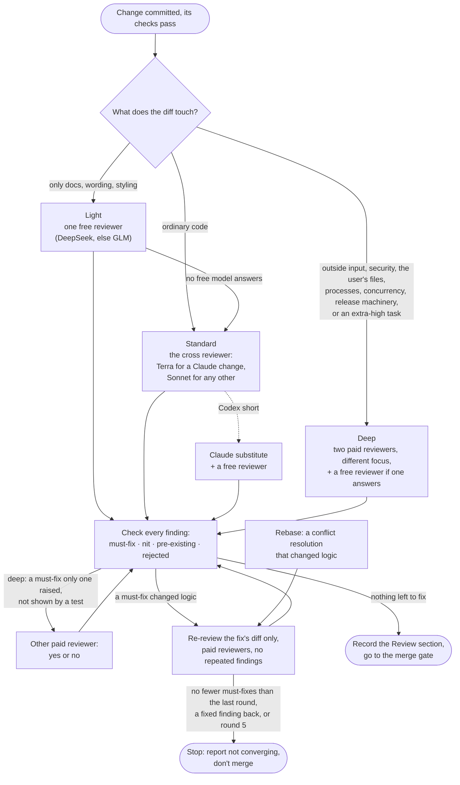

# review-gate

An agent's change merges only after agents that didn't write it have read it. The agent that made the
change runs the gate itself: it picks a level from what the diff touches, launches reviewers of other
model families, checks every finding, fixes what is real and records the result in a fixed format.
The long-horizon orchestrator runs it in every task; a person can also ask for it directly.

Version and history: [CHANGELOG.md](CHANGELOG.md). Why it works this way: [evidence.md](evidence.md).

## The flow

## Who reviews

| Level | Round 1 | Later rounds |
|---|---|---|
| Light | one free reviewer; if none answers, the cross reviewer | the cross reviewer, only after a logic fix |
| Standard | the cross reviewer (Codex short: its Claude substitute + a free reviewer) | the paid reviewer who found the must-fix, or the cross reviewer for a fix only a free reviewer asked for |
| Deep | two paid reviewers, different focus, + a free reviewer if one answers | the paid reviewers who found must-fixes |

- **Paid reviewers** run at high reasoning: Codex's GPT-6.1 Terra (preferred to Sol, which costs more of
  the Codex plan), Claude Sonnet 5.5 and Opus 5.5.
- **Codex is preferred but never required:** when it is short, a Claude model other than the change's
  author takes its place, and a free reviewer brings back a second family.
- **Free reviewers** (OpenCode's DeepSeek V4.1 Flash and GLM-5.3 Flash) run on OpenCode's free tier,
  which shares one limit for the whole computer with the tasks' research helpers, and then on the owner's
  flat-rate OpenCode Go plan. So they review first rounds only, and only where they help most for least:
  alone on light changes, as an extra voice on deep ones, and in place of the lost family when Codex is
  short. A limited one moves from the free tier to Go (unless Go's windows are past about 85%), and when neither answers it is dropped, or at light
  the cross reviewer takes its place. It is never waited for past its time, and one with no activity
  5 minutes after launch, or whose turns come more than a minute apart, is replaced then. Its brief gives it 12 minutes
  and about 20 commands, so it reports before its time runs out.
- **Gemini doesn't review:** its reviews were the weakest in past runs.
- **Trial reviewers:** GPT-6 Luna, Claude Haiku 5.5 and Muse Spark 1.3 Contributor add one cheap extra
  review in round 1 at Standard and Deep, split evenly across a run's tasks. Their findings are checked and fixed
  like any other, but the gate never rests on them. Once each has about 20 reviews, a study compares
  them with Terra and Sonnet: must-fixes found, must-fixes nobody else found, and findings rejected.
  One that holds up could take Terra's or Sonnet's place at Light, or stand in when Codex is short.

## The record

Every gate ends with a verdict line and a table like these, which later studies count:

**Review: Deep, 2 rounds.** It reads socket input. 3 must-fixes found, all fixed.

| Reviewer | Rounds | Must-fix | Nits | Pre-existing | Rejected | Unique must-fix |
|---|---|---|---|---|---|---|
| Codex GPT-6.1 Terra, high | 1, 2 | **2** | 3 | 1 | 1 | 1 |
| Claude Sonnet 5.5, high | 1 | **1** | 4 | – | 2 | – |
| GPT-6 Luna, high (trial) | 1 | – | 2 | – | 1 | – |

*Skipped: DeepSeek V4.1 Flash (free): Free usage limit reached; DeepSeek V4.1 Flash (Go): no answer in its time.*
