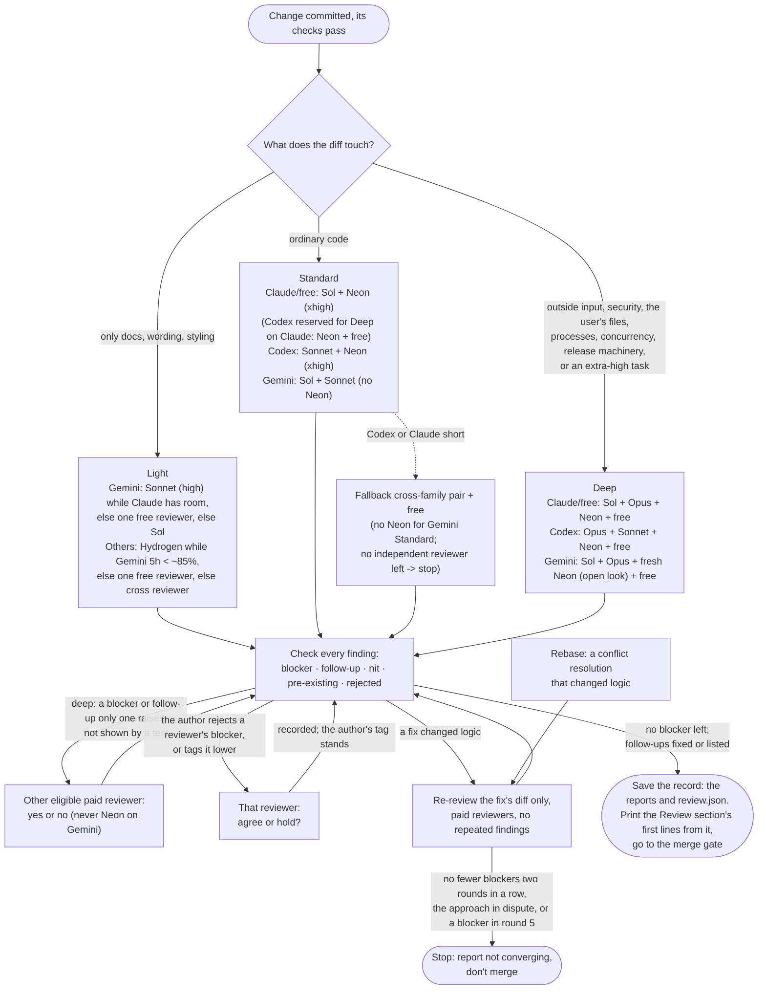

# review-gate

An agent's change merges only after agents that didn't write it have read it. The agent that made the
change runs the gate itself: it picks a level from what the diff touches, launches reviewers of other
model families, checks every finding, fixes what is real and records the result in a fixed format.
The long-horizon orchestrator runs it in every task; a person can also ask for it directly.

Version and history: [CHANGELOG.md](CHANGELOG.md). Why it works this way: [evidence.md](evidence.md).

## The flow

## Who reviews

| Level | Round 1 | Later rounds |
|---|---|---|
| Light | Gemini changes: Sonnet (`high`) while a Claude bucket has room, else one free reviewer, else Sol (`no reviewer available` if Codex is also short). Others: Gemini 4 Hydrogen while `gemini_models_five_hour` is under ~85%, else one free reviewer, else the cross reviewer (`Sonnet` for Codex, or `Neon` if Claude is short; `Sol` for Claude/free, or under Codex short: other Claude model for Claude — `Neon` only if Claude is also short — and `Sonnet` for free). | `Sonnet` on Gemini Light (when it reviewed), or the cross reviewer, only after a logic fix |
| Standard | Claude/free: Sol + Neon (`xhigh`); under Codex reserved-for-Deep, Claude drops Sol to Neon + one free (or Sol + free if Neon can't review). Codex: Sonnet + Neon. Gemini: Sol + Sonnet (strictly cross-family, no Neon). Fallbacks cover Codex short, Claude short, and Neon unavailable (stopping if no eligible reviewer remains). | the paid reviewer who found the fixed finding (Sol stays on its findings even when reserved for Deep), or the cross reviewer for a fix only Hydrogen, a free reviewer or Haiku asked for |
| Deep | Claude/free: Sol (logic/security/failure paths) + Opus (tests/docs/UX/project rules; fresh if Opus/Fable) + Neon (open look) + free. Codex: Opus + Sonnet + Neon + free (with Claude short: Neon + fresh Sol + free when tests/docs/UX/rules are touched and Codex isn't short, else Neon full diff + free). Gemini: Sol + Opus + fresh Neon (`xhigh`, round-1 open look ONLY) + free. Codex-short and Claude-short fallbacks split focuses across remaining paid families and free (giving Sol the full diff when Claude is short, never Neon on Gemini's focused roles, re-reviews, tag questions, or second opinions; stopping if no eligible reviewer remains). | the eligible paid reviewers who found the fixed findings (logic fixes raised only by fresh Neon on Gemini Deep route to the cross reviewer) |

- **Paid reviewers:** Codex's GPT-6.2 Sol at `medium` reasoning, Claude Sonnet 5.5 and Opus 5.5 at `high` (on `claudeAgent`, or on Antigravity's separate `claude_and_gpt_models` bucket while its 5-hour and weekly windows are under ~80%), and Neon (`Gemini 4 Neon` at `xhigh`).
  Sol replaced GPT-6.1 Terra in 8.0.0: on the benchmark it found 61 of the 144 defects known before its run
  and 17 of 20 blockers, where Terra found 42 and 9, and none of its findings were false
  ([evidence.md](evidence.md#gpt-62-sol-at-medium-2026-11-18)).
- **Antigravity's Claude bucket and "Claude is short":** Opus and Sonnet seamlessly fail over between `claudeAgent` and Antigravity's `claude_and_gpt_models` bucket (`interactionMode: "plan"`, `thought_level: "high"` in T3). Claude counts as short only when both buckets are limited or unavailable; explicit fallbacks then cover every author family and level, excluding Claude Haiku 5.5 from the free order (Haiku is also excluded whenever `claudeAgent` is short, since Antigravity has no Haiku) ([evidence.md](evidence.md#plain-gemini-4-neon-at-xhigh-gemini-authored-changes-and-bucket-balance-2026-11-22)).
- **At Deep, a Claude change's Claude reviewer is Opus,** whichever Claude model wrote it: for Opus's own
  change, Opus as a new agent with the brief alone. On the benchmark Opus found 10.5 of the 20 blockers
  and Sonnet 5, and Terra with Opus found 69 defects and 14 blockers where Terra with Sonnet found 63 and
  11 ([evidence.md](evidence.md#opus-as-deeps-claude-reviewer-2026-11-18)). Sonnet stays the cross reviewer
  of a change Codex wrote (and Light's reviewer on Gemini changes), Opus's partner at Deep on Codex changes and Codex-short Gemini changes, and the Claude substitute for Opus's
  change when Codex is short and Neon can't review.
- **Codex soft-reserve ("Codex is reserved for Deep") and "Codex is short":** an orchestrator or brief can reserve Codex for Deep reviews (before the hard "Codex is short" cutoff, never self-detected per task so parallel gates don't race). Standard reviews of Claude changes then drop Sol for Neon + one free (keeping Sol if Neon can't review), while Deep reviews, Gemini/Codex/free changes, Light fallbacks, and Sol re-reviews keep Sol until Codex is short. When Codex is short, Neon takes Sol's place on Claude changes at Standard and Deep (while Gemini changes run Opus + Sonnet + free, plus fresh Neon open look at Deep).
- **Free reviewers** (OpenCode's DeepSeek V4.1 Flash and GLM-5.3 Flash) run on OpenCode's free tier,
  which shares one limit for the whole computer with the tasks' research helpers, and then on the owner's
  flat-rate OpenCode Go plan. So they review first rounds only, and only where they help most for least:
  alone on light changes when Hydrogen or Sonnet can't review, in Neon's or Sol's place on standard ones, as an extra
  voice on deep ones, and in place of a short paid family. A limited one moves from the free tier to Go (unless Go's windows are past about 85%), and when neither answers, Claude Haiku 5.5 comes last at standard and deep (excluded when Claude is short, or for a Claude change while Codex is short); at light
  the cross reviewer takes its place. It is never waited for past its time, and in T3 one with no activity
  5 minutes after launch, or whose turns come more than a minute apart, is replaced then. Its brief gives it 12 minutes
  and about 20 commands, so it reports before its time runs out.
- **Neon (`Gemini 4 Neon`, `xhigh`) replaced Orchestrator (Neon) in 8.6.0:** direct inspection of 53 read-only Orchestrator (Neon) review databases showed 0 calls to its faster worker model, making it identical to plain `gemini-4-neon` at `xhigh` during code reviews (formal `reviewer-benchmark` confirmation of `gemini-4-neon-xhigh` is pending; [evidence.md](evidence.md#plain-gemini-4-neon-at-xhigh-gemini-authored-changes-and-bucket-balance-2026-11-22)). In 8.5.0 Orchestrator (Neon) found 62% of 194 known defects and 23 of 27 blockers on the benchmark's 16 past changes, the most of any model, with 2.4% false findings ([evidence.md](evidence.md#orchestrator-neon-as-a-reviewer-2026-11-21)). On Gemini-authored changes, fresh Neon (`xhigh`) joins only at Deep for an open look (never Light, Standard, cross review, focused Deep roles, or second opinions).
- **Gemini 4 Hydrogen reviews at Light only** (for non-Gemini changes), while `gemini_models_five_hour` is under about 85% (raised from 60% in 8.6.0 on Google AI Ultra). It found
  27% of the defects and 6 of 27 blockers. Plain Gemini 4 Neon at `high` (which found 50%) and all other unbenchmarked Gemini models remain excluded.
- **The trial is over.** Four cheap models each added one extra review in round 1 until 6.0.0. A study of 92
  gates and the benchmark settled them: Hydrogen got its place (Light's alone since 8.5.0), Claude Haiku 5.5 ends the free order at
  Standard and Deep, and GPT-6 Luna and Muse Spark 1.3 Contributor got none. A new model is measured with
  the [reviewer-benchmark](../reviewer-benchmark/README.md) skill, on the same past changes as the others,
  before the owner gives it a place.

## When the author tags a blocker lower

The author decides each finding's tag, and only the author's blockers hold back a merge. That keeps a run
moving, but it leaves the author judging findings about its own change. So when the author rejects a finding
its reviewer tagged a blocker, or gives it a lower tag, the gate gives it back to that reviewer with the
author's reason and asks: agree or hold? (A free reviewer's, Hydrogen's or Haiku's goes to the round's cross reviewer.)

- **It never blocks.** The author's tag stands whatever the answer. A reply can't turn a finding into a
  blocker, hold back the merge, count toward the stop rule or start a fix or another round in that gate. If
  it convinces the author, the most that happens is that the finding is listed as an open follow-up, which
  is fixed after the merge like any other. A reviewer that doesn't answer in ten minutes is recorded as "no
  answer".
- **It is visible.** The reply goes in the record, the Review section counts the replies and lists each
  blocker a reviewer held on with both sides, and the orchestrator's report puts those under "Worth checking
  yourself".
- **Why it is only recorded:** reviewers tag high, and a reviewer asked about its own finding will often
  hold. The point is to see how often an author's reason doesn't convince the reviewer, and whether those
  findings later turn out to matter ([evidence.md](evidence.md#the-reviewers-reply-2026-11-14)).

## The record

Every gate ends with a Review section that starts with lines like these, printed from the gate's record, which later studies count:

**Review: Deep, 2 rounds.** It reads socket input. 2 blockers and 1 follow-up found, all fixed.

| Reviewer | Rounds | Blockers | Follow-ups | Nits | Pre-existing | Rejected | Unique defects |
|---|---|---|---|---|---|---|---|
| Codex GPT-6.1 Terra, high | 1, 2 | **1** | 1 | 3 | 1 | 1 | 1 |
| Claude Sonnet 5.5, high | 1 | **1** | – | 4 | – | 2 | – |
| Gemini 4 Hydrogen, high | 1 | – | – | 2 | – | 1 | – |

(The example predates 8.0.0, when Terra was the Codex reviewer.)

*Tagged lower than the reviewer's blocker or follow-up: 1 (1 rejected).*

*Replies on the blockers tagged lower: 1 agreed, 0 held, 0 no answer.*

*Skipped: Claude Opus 5.5: usage limit; DeepSeek V4.1 Flash (free): Free usage limit reached; DeepSeek V4.1 Flash (Go): no answer in its time.*

*Record: ~/.local/state/agent-skills/long-horizon-orchestrator/run/task-B/review.*

Behind those lines is a folder each gate leaves, so a study can check the author's account against what the
reviewers said ([evidence.md](evidence.md#the-record-2026-11-14)):

- **Each reviewer's report,** saved whole when it arrives.
- **`review.json`:** the level, the result, the commits reviewed, and one entry per finding per reviewer who
  raised it: the reviewer's tag, the author's tag, how the author checked it (a test, a run, reading the code,
  a second opinion), the commit that fixed it, a line of why wherever the author rejected it or tagged it
  lower than the reviewer did, and, where that finding was the reviewer's blocker, what the reviewer answered
  when asked.
- **Where:** a task's `review/` folder in an orchestrated run, which the orchestrator's pruning keeps;
  otherwise `~/.local/state/agent-skills/review-gate/`, so a gate run by hand leaves a record too. Never in
  the repository under review. The gate makes the folder with plain `mkdir` and takes the next name when
  one exists, so two gates never write into the same folder.

`scripts/review-records table <folder>` checks the record and prints the verdict line's start, the table and
the lines under it, so nobody counts them by hand. `scripts/review-records totals` adds up every record
on the computer: gates by level, result and rounds, each reviewer's findings, and how often the author's tag
differed from the reviewer's. For gates before 4.1.0 it reads the table in each task's handoff, which gives
the counts but not the reviewers' own tags. The "Record" line is how it tells the two apart: a handoff's
table with that line under it is counted from the record the line names, when that is one of this task's
records in this run or a record kept under `review-gate/`, and one without it is a gate that left no record.
If the named record is gone, can't be read or is another task's, the handoff's table counts instead. A
handoff table with no verdict line of its own (an updated table, one more look) adds to another gate and
isn't counted as one.

What a gate missed isn't recorded during a run. The record names the commits it reviewed, so a study can
look in git for later fixes to the same code.
