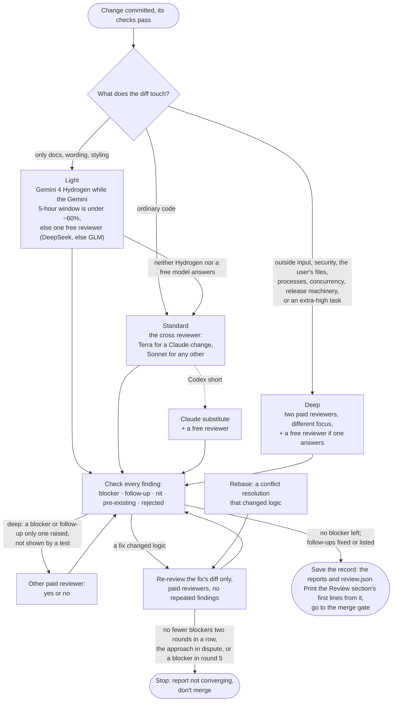

# review-gate

An agent's change merges only after agents that didn't write it have read it. The agent that made the
change runs the gate itself: it picks a level from what the diff touches, launches reviewers of other
model families, checks every finding, fixes what is real and records the result in a fixed format.
The long-horizon orchestrator runs it in every task; a person can also ask for it directly.

Version and history: [CHANGELOG.md](CHANGELOG.md). Why it works this way: [evidence.md](evidence.md).

## The flow

## Who reviews

| Level | Round 1 | Later rounds |
|---|---|---|
| Light | Gemini 4 Hydrogen while the Gemini 5-hour window is under about 60%, else one free reviewer; if none answers, the cross reviewer | the cross reviewer, only after a logic fix |
| Standard | the cross reviewer (Codex short: its Claude substitute + a free reviewer) | the paid reviewer who found the fixed finding, or the cross reviewer for a fix only a free reviewer asked for |
| Deep | two paid reviewers, different focus, + a free reviewer if one answers | the paid reviewers who found the fixed findings |

- **Paid reviewers** run at high reasoning: Codex's GPT-6.1 Terra (preferred to Sol, which costs more of
  the Codex plan), Claude Sonnet 5.5 and Opus 5.5.
- **Codex is preferred but never required:** when it is short, a Claude model other than the change's
  author takes its place, and a free reviewer brings back a second family.
- **Free reviewers** (OpenCode's DeepSeek V4.1 Flash and GLM-5.3 Flash) run on OpenCode's free tier,
  which shares one limit for the whole computer with the tasks' research helpers, and then on the owner's
  flat-rate OpenCode Go plan. So they review first rounds only, and only where they help most for least:
  alone on light changes, as an extra voice on deep ones, and in place of the lost family when Codex is
  short. A limited one moves from the free tier to Go (unless Go's windows are past about 85%), and when neither answers it is dropped, or at light
  the cross reviewer takes its place. It is never waited for past its time, and in T3 one with no activity
  5 minutes after launch, or whose turns come more than a minute apart, is replaced then. Its brief gives it 12 minutes
  and about 20 commands, so it reports before its time runs out.
- **Gemini isn't a regular reviewer,** except Hydrogen at Light: Gemini's reviews were the weakest in past
  runs, but Hydrogen found half the known defects on five past changes, against DeepSeek's third
  ([evidence.md](evidence.md#gemini-4-hydrogen-as-a-reviewer-2026-11-13)). It stays on trial at Standard and
  Deep, and its Light reviews count toward that trial. The 60% limit keeps room in the Gemini window for the
  run's helpers, which share it.
- **Trial reviewers:** GPT-6 Luna, Claude Haiku 5.5, Muse Spark 1.3 Contributor and Gemini 4 Hydrogen add one cheap extra
  review in round 1 at Standard and Deep, split evenly across a run's tasks. Their findings are checked and fixed
  like any other, but the gate never rests on them. Once each has about 20 reviews, a study compares
  them with Terra and Sonnet: blockers and follow-ups found, those nobody else found, and findings rejected.
  One that holds up could take Terra's or Sonnet's place at Light, or stand in when Codex is short.

## The record

Every gate ends with a Review section that starts with lines like these, printed from the gate's record, which later studies count:

**Review: Deep, 2 rounds.** It reads socket input. 2 blockers and 1 follow-up found, all fixed.

| Reviewer | Rounds | Blockers | Follow-ups | Nits | Pre-existing | Rejected | Unique defects |
|---|---|---|---|---|---|---|---|
| Codex GPT-6.1 Terra, high | 1, 2 | **1** | 1 | 3 | 1 | 1 | 1 |
| Claude Sonnet 5.5, high | 1 | **1** | – | 4 | – | 2 | – |
| GPT-6 Luna, high (trial) | 1 | – | – | 2 | – | 1 | – |

*Tagged lower than the reviewer's blocker or follow-up: 1 (1 rejected).*

*Skipped: DeepSeek V4.1 Flash (free): Free usage limit reached; DeepSeek V4.1 Flash (Go): no answer in its time.*

*Record: ~/.local/state/agent-skills/long-horizon-orchestrator/run/task-B/review.*

Behind those lines is a folder each gate leaves, so a study can check the author's account against what the
reviewers said ([evidence.md](evidence.md#the-record-2026-11-14)):

- **Each reviewer's report,** saved whole when it arrives.
- **`review.json`:** the level, the result, the commits reviewed, and one entry per finding per reviewer who
  raised it: the reviewer's tag, the author's tag, how the author checked it (a test, a run, reading the code,
  a second opinion), the commit that fixed it, and a line of why wherever the author rejected it or tagged it
  lower than the reviewer did.
- **Where:** a task's `review/` folder in an orchestrated run, which the orchestrator's pruning keeps;
  otherwise `~/.local/state/agent-skills/review-gate/`, so a gate run by hand leaves a record too. Never in
  the repository under review. The gate makes the folder with plain `mkdir` and takes the next name when
  one exists, so two gates never write into the same folder.

`scripts/review-records table <folder>` checks the record and prints the verdict line's start, the table and
the two lines under it, so nobody counts them by hand. `scripts/review-records totals` adds up every record
on the computer: gates by level, result and rounds, each reviewer's findings, and how often the author's tag
differed from the reviewer's. For gates before 4.1.0 it reads the table in each task's handoff, which gives
the counts but not the reviewers' own tags. The "Record" line is how it tells the two apart: a handoff's
table with that line under it was printed from a record and is counted there, and one without it is a gate
that left no record.

What a gate missed isn't recorded during a run. The record names the commits it reviewed, so a study can
look in git for later fixes to the same code.
