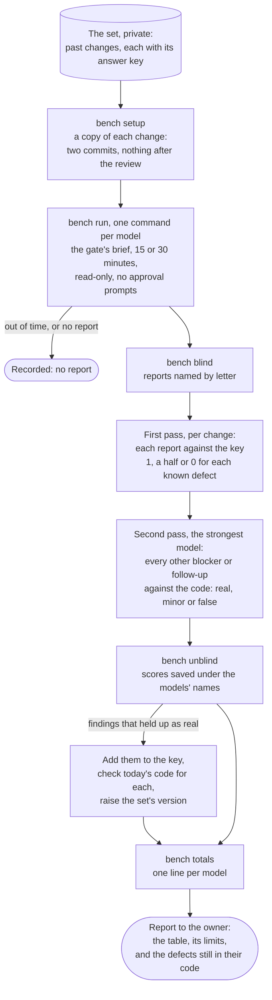

# reviewer-benchmark

How good is a model at reviewing code? The review gate's trial answers that slowly: one extra review at a
time, each model on different changes, beside different reviewers. This skill answers it in an evening: every
model reviews the same past changes, whose defects are known, and its reports are scored without the scorer
knowing who wrote them.

Version and history: [CHANGELOG.md](CHANGELOG.md). Why it works this way: [evidence.md](evidence.md).

## The flow

## What the table says

| Column | What it counts |
|---|---|
| Reports | Reviews that came back with a report, of those tried. One that ran out of time counts as none. |
| Known found | Defects of the key the report described: 1 each, a half for the right code without the failing case. |
| Blockers | The same, for the key's blockers alone. |
| Alone | Known defects only that model found in full, among the models that tried every change. |
| Real | Its findings outside the key that held up against the code. They join the key for the next version. |
| Minor | Findings outside the key that are true but trivial, or were there before the change. The author still has to read them. |
| False | Findings outside the key that the code contradicts. |
| False share | False findings among all the blockers and follow-ups it raised. |
| Min/review | Time per review, timed-out ones included. |

## Where things live

- **This repository:** the skill, its script and its test, with a made-up set.
- **The owner's private state repository,** `reviewer-benchmark/`: the set, its keys, every model's reports
  and scores, and the table of each run. It quotes the owner's code and never comes here.
- **The cache:** the copies to review in one folder, and the blind copies and logs in another, so that a reviewer
  looking around its copy doesn't find another's report beside it. Deleted freely once scores are saved.
- **The repositories the changes came from:** only read, apart from the names that keep each key's two
  commits from being deleted.

## What it doesn't decide

Who reviews in the review gate. The table is evidence; a change of reviewers is the owner's, through
`skill-evolution`.
