# sketch-infographic diagram gallery

What each diagram in [references/diagrams.md](../../../../skills/sketch-infographic/references/diagrams.md) looks like, built from the snippet there with no changes. Use it to pick a kind ("like the sequence one") when there's no example image to hand. Agents read the catalog, not this page.

Rebuild after changing a diagram: `./docs/skills/sketch-infographic/gallery/build`.

| Diagram | Use it for |
|---|---|
| 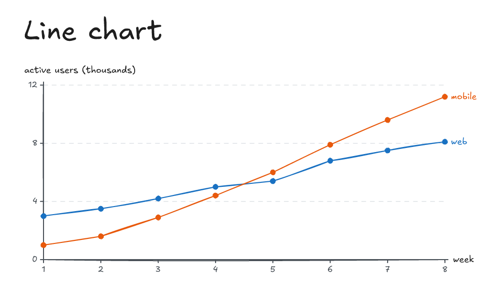 | **Line chart:** how a value changed, with real numbers |
| 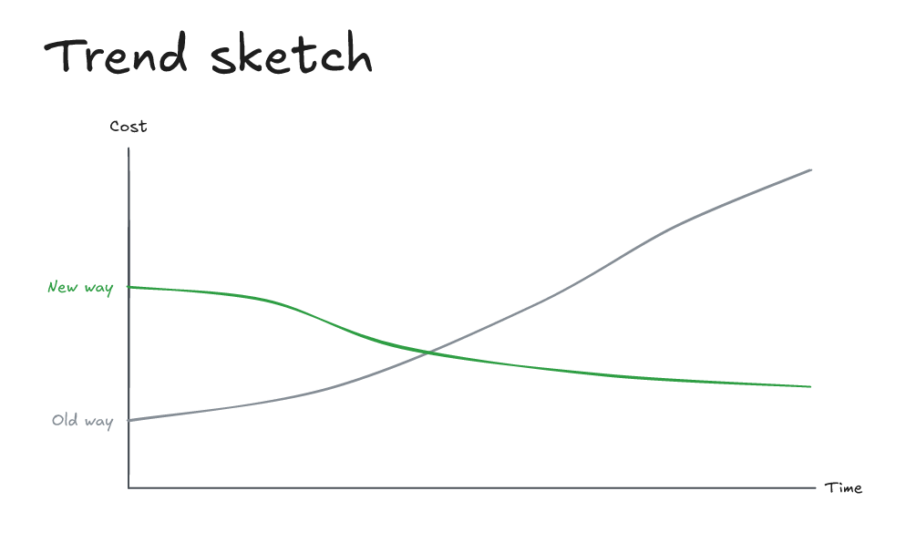 | **Trend sketch:** a shape over time, no measurements |
| 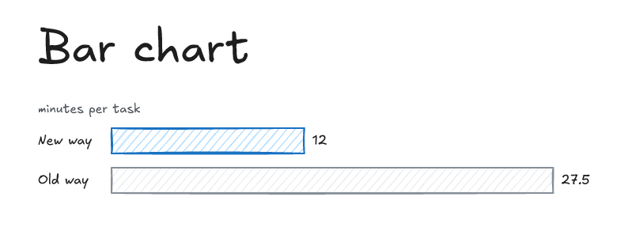 | **Bar chart:** a few quantities side by side |
| 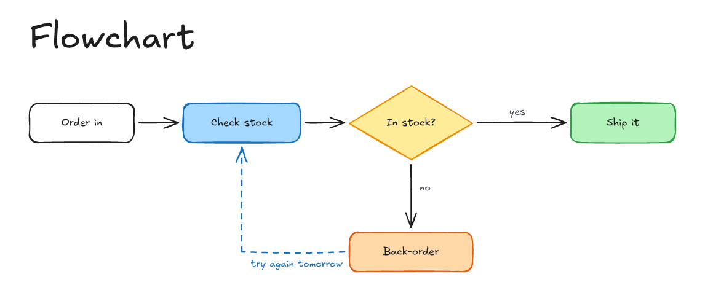 | **Flowchart:** steps, a decision, a retry |
| 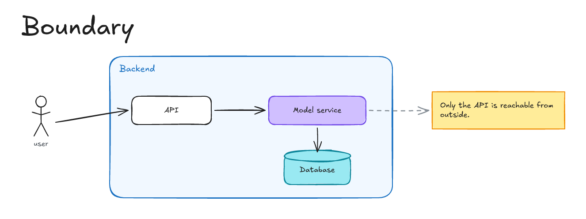 | **Boundary:** what sits inside what, and which parts talk |
| 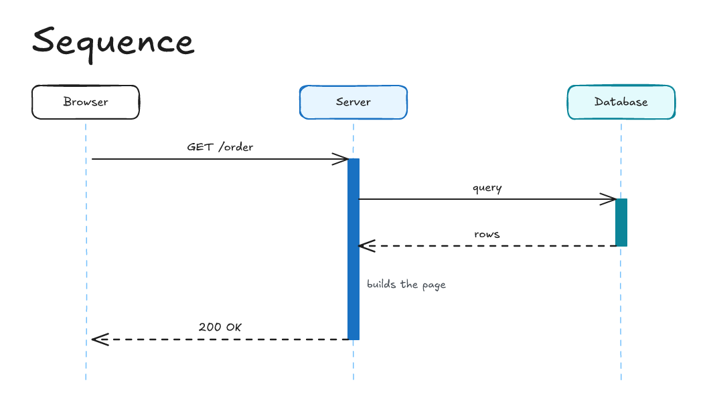 | **Sequence:** who sends what to whom, in what order |
| 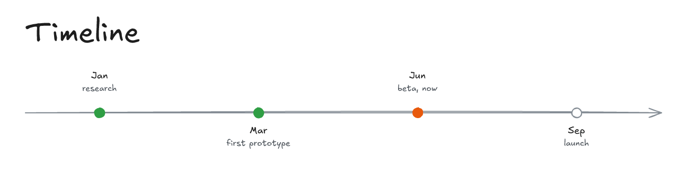 | **Timeline:** when things happened or will |
| 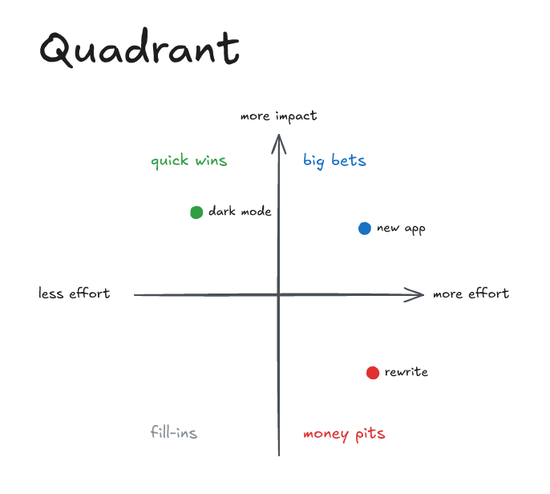 | **Quadrant:** items sorted on two scales |
| 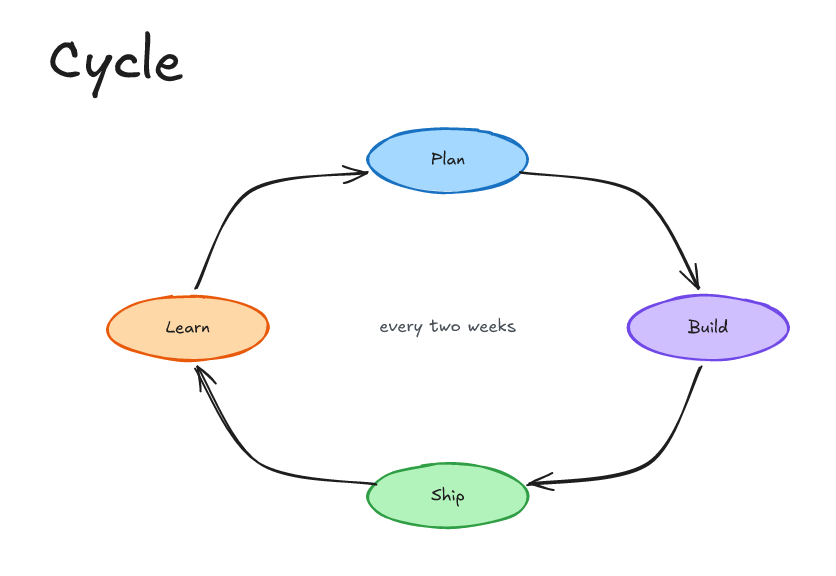 | **Cycle:** a process that repeats |
| 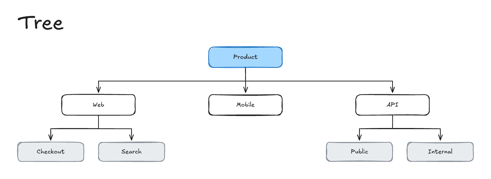 | **Tree:** the parts of a whole |
| 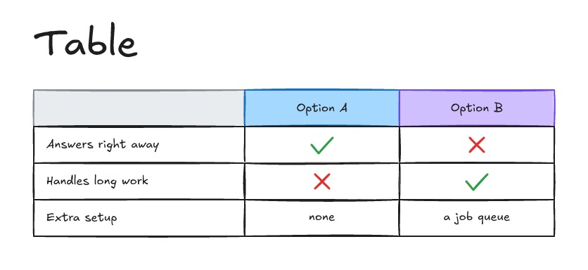 | **Table:** options compared on several criteria |
