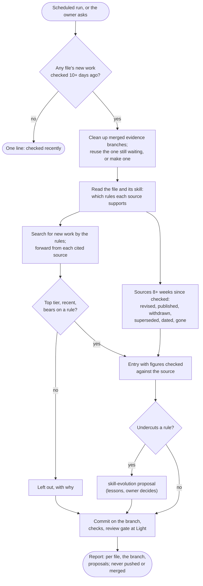

# skill-evidence

Each skill's `evidence.md` here says which sources and studies its rules rest on. Those files go stale
quietly: a preprint gets published or withdrawn, a lab posts newer figures, a result measured on
last year's models stops holding. This skill keeps them current. It searches for new top-tier work
that bears on each skill's rules, rechecks the sources already cited, and prepares the edits on a
branch for the owner to merge. A finding that undercuts a rule becomes a skill-evolution proposal,
so rules still change only with the owner's yes.

Version and history: [CHANGELOG.md](CHANGELOG.md).

## The flow

## The schedule

A T3 scheduled task in the agent-skills project runs it every Friday morning; the skill itself skips
files checked under 10 days ago, so each file is searched about every two weeks and its cited sources
rechecked about every two months. Each run posts its report in a thread of its own. The owner's
personal reading digest is separate: it takes anything worth reading that week, this only what meets
the bar and bears on a rule.

## Where things live

- **The bar** for a source is in the skill ([references/bar.md](../../../skills/skill-evidence/references/bar.md)):
  first-party reports by labs and makers of coding agents, peer-reviewed main-track papers, evaluation
  organizations, and preprints from established groups, from the last 24 months, tying to a named rule.
- **Each evidence file** starts with `Last checked: new work <date>; sources <date>.` and ends with
  "Left out": what a run weighed and rejected, with why, so the next run doesn't weigh it again.
- **The edits** wait on one branch, `evidence/<date>`, in a worktree beside the repository, until the
  owner merges it with `git merge --ff-only`; a later run cleans up merged ones and adds to one still
  waiting.

## Why

The orchestrator's evidence file was written on 2026-10-31, and a first-party article that bore on
its rules (Anthropic on folding subagents into one loop, 22 October 2026) was found only because the
owner asked about it that same day. A file checked by hand once is out of date within weeks in a field
that moves this fast.
