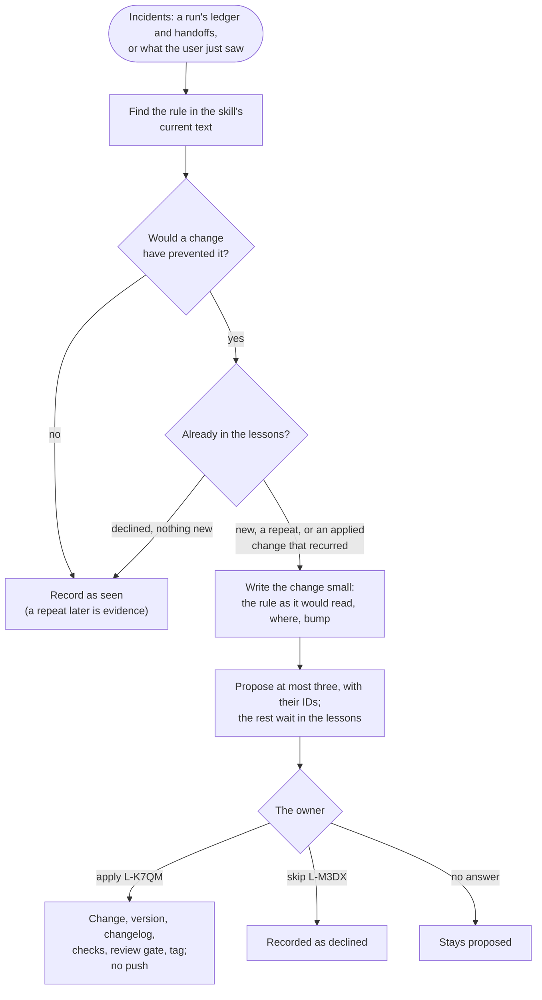

# skill-evolution

Skills evolve from what actually happened to them, never on their own. This skill turns incidents (what cost the owner
time, work or an interruption because a skill's rules caused it or didn't prevent it) into at most
three proposed changes, each with its evidence and version bump. The owner decides; nothing changes
until they name a proposal. The long-horizon orchestrator runs it at every finish, from the incidents
its ledger records during the run; anyone can also ask for it after a skill misbehaved.

Version and history: [CHANGELOG.md](CHANGELOG.md).

## The flow

## Where things live

- **The lessons** are private: one file per entry in the owner's state repository
  (`skill-evolution/lessons/<ID>.md`), so run names and project details stay out of this public
  repository. `skills/skill-evolution/scripts/lessons` is the only writer: each entry's own file
  and a random ID that never changes mean two computers never edit the same text, nothing is
  renumbered, and an ID shown to the owner holds for good.
- **An applied change** lands here like any other: the skill's version raised, its changelog entry
  with the evidence in aggregate, and longer evidence in `docs/skills/<skill>/evidence.md`.

## Why

Until 2026-10-31 every improvement to the skills came from the owner noticing a problem and asking:
for example, run folders grew to 14.6 GB over three weeks while the incident that showed it sat in
a run's notes. Asking for proposals at every finish catches these while the evidence is fresh, and
the owner's yes per proposal keeps one odd night from drifting a skill.
