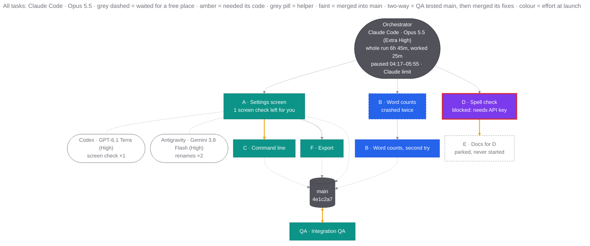

# Final report

The reader is returning after hours away, and probably after several tasks' worth of activity. They want to know whether it worked, what is new, and what they need to decide. Write for that person, not for a reviewer.

## Rules

- Post the report in the chat as your final message, every time the run ends: all tasks merged, some blocked or parked, or stopped early. Post it again, whole and updated, when the outcome changes later, for example after the user's own check lets a blocked task merge. Save a copy in the run directory, but a saved file is not a report the user has received.
- Use plain language. Describe each new thing by what the user can now do, and where to find it. Leave out file names, function names, test counts, commit IDs and review mechanics unless the user needs them to act.
- Gather open decisions from every task's handoff and from your decisions log. Remove duplicates, and phrase each one as a question with one sentence of context.
- Recommend an answer to each open decision, and to each next step where there is a real choice (whether to do it, when, or how). Base it on what the run learned, such as the tasks' findings, their recommendations and the checks, and give the reason in one sentence. When you have no good basis, say so and name what would settle it. Label it as a recommendation: the decision stays the user's, and nothing was built on it. Never present something a task chose on its own as settled.
- Be honest about anything that didn't finish, was blocked or wasn't verified, such as untested operating systems or a skipped check. One line each is enough.
- Offer the technical detail rather than including it. Each task's full handoff is in its thread and the run directory, and the ledger holds the rest. Never link to `/tmp`.
- A report posted while tasks still run begins with "Interim report:" and names what is still running. The final report is the run's last act: nothing new starts after it without the user's go-ahead.
- Show what changed: the tasks' pictures under their items ("Pictures" below), and in T3 the run map right above the report ("Run map").
- With OrbOS's tools, offer the report to listen to, with its tour, once, just before posting it ("Offer it to listen to, with its tour" below). The tour waits with the reading for the user to play, so no live tour is needed; give one only when the offer couldn't keep it. Neither changes the report, and neither holds up the finish.

## Template

```markdown
<One or two sentences: is everything merged into <integration branch>, was anything pushed, and the one thing to do to see it (for example "restart the API server").>

## What was built

**1. <Plain name> (Task A)**
<Two or three sentences in everyday language: what you can now do, and where to find it.>
<If it changed something you can see: its pictures, each on its own line. In T3, ``; elsewhere, `<caption>: <absolute path>`.>

**2. ...**

## How it ran

<The run-time line from `summary.txt` (see "The run's facts" below), for example: "Run time: 6h 45m (00:50–07:35), including 1h 38m paused for quota (a pause that stopped only some tasks names them instead: 'with C and E paused for quota at times'). The orchestrator worked 25m over 18 wakes; the tasks worked 5h 06m together, with at most 4 running at once.">

<With usage samples: the usage line from `summary.txt`, its second line (see "Usage graphs" below), for example: "Usage: Claude weekly 62% → 59% left; Codex weekly 100% → 96% left; Antigravity Gemini weekly 100% → 94.6% left, Gemini 4 Argon weekly 76.7% → 58.2% left; Copilot monthly 88% → 85% left. The Mac peaked at 72% CPU, 61% GPU and 49.8 of 64 GB memory, and free disk went from 168.6 to 151.2 GB.">

<Outside T3 only: the dependency graph and the timeline; see "Run charts" below, and the usage charts when there are any ("Usage graphs"). In T3 the run map above the report shows all of them.>

<One or two lines the map or charts can't say on their own, such as why the pauses happened, why effort levels changed, a helper that hit a rate limit and what its work switched to, or what you changed because the user asked during the run.>

## Not finished
<Only if some tasks are blocked, parked or failed, or merged with a narrow miss.>
- **<Task>:** what's missing, why, and what it needs from you.
- **<Task>, parked:** when it last worked and that nothing continued it after that, what its thread shows in the user's sidebar and why (a thread whose last turn ended on a quota error shows "Failed"), and that the thread and its worktree are kept for the next run, so it stays unsettled until then.
- **<Task> merged one check short:** <the check, its result against its threshold>; <the follow-up task> carries it<, and how that ended>.

## Worth checking yourself
<Only if some checks couldn't run, from the tasks' "unchecked" lines, for example real-screen checks while the screen was locked.>
- **<Where to look>:** what to try, and what it should do.

## Side effects on your computer
<Only if any. One line each, with the time: dialogs that appeared and how they were answered, permissions or settings changed and restored, services reinstalled, files left or removed (test builds' sandbox containers, which need your password to delete, are safe to remove), disk space used and freed, and anything the run couldn't restore.>

## Open decisions

1. **<Short label>.** <One sentence of context.> <The question?>
   **Recommended:** <the option you would pick>, because <one sentence, from what the run found>. <Or: "No recommendation: <what would settle it>.">
2. ...

## Suggested next steps
<Follow-ups the tasks recommended, or that you noticed, the one you recommend most first.>
- <The step.> **Recommended:** <whether to do it, when, or how, such as "do this before the release", "fold it into <other step>", or "skip it unless <condition>">, because <one short reason>. <Leave the recommendation out when there is no real choice.>

<One closing line: checks passed on <OS>, <other OSes> untested; branches and worktrees cleaned up (or what was kept, and how to restore); ledger at <path>; run map at <path>/run-map.html, to open in a browser; detailed technical notes available on request. By how the offer went: offered with its tour, add "The report waits in the notch to listen to, with a tour of the run: press Tour."; offered without it, add "The report waits in the notch to listen to."; and either way without its tour, with OrbOS's walkthrough tool, add "Ask me to walk you through the run for a tour in the notch (its steps are in <run directory>/report/tour.json)." Not offered: nothing. Add this clause after report-offer has offered the saved copy, so the card's Full Text lacks only it.>

<One usage line, for example: "Usage: Claude Max 20x went from 9% to 31% of the week; Codex Plus from 16% to 22%; Antigravity Argon from 1% to 9% of its week." Add any pause for a reset (which tasks, from when to when), and any other run that used the same subscriptions meanwhile.>
```

## Pictures

A task that changes something you can see leaves one to three pictures of it with captions, listed under "Pictures" in its handoff ([task-brief.md](task-brief.md)).

- Show them under the task's item in "What was built", and list them in the task's `pictures` in the facts file, so the run map shows them on its card too.
- Use them as they are. Don't open them to check them: each task took them from its own build with sample content, and looking costs your context. Open one only when its caption is missing or unclear.
- They stay in the run directory. Never copy them into a repository, and never link to `/tmp`.
- A task with nothing visible to show leaves none.

## The run's facts

The run map, the charts and the run-time line are all drawn from one facts file of the run as it actually happened, not as planned.

### Where the facts come from

- **Harness, model and reasoning level:** the host's record you saved at launch, never an agent's description of itself. Note every level change you made during the run.
- **Launch time:** the host's creation time for the task's thread or agent. Convert UTC to the user's local time.
- **Merge time:** the integration branch's reflog, which shows when each task's merge moved it (`git reflog show <branch> --date=format-local:'%H:%M:%S'`). A commit's own date is not its merge time: rebases rewrite it.
- **Worked time:** the sum of the task's turns, each from its start to its completion, from the host's per-turn records (in T3, see [host-t3.md](host-t3.md)). It counts only the task's own agent, not helpers it waited on. Cap it at the total when a task kept talking after its merge. Keep the turns themselves too (a task's `turns`, and the run's for your own): the map's timeline draws them. If the host has no per-turn times, show only the total and say so once under the chart.
- **The whole run:** from the user's approval of the contract (its time is in the ledger) to the final report. Your own worked time is the sum of your turns in that span, from the host's per-turn records of your own thread, and the number of those turns is your wake count. If the host has no per-turn times, give the run's span only.
- **Quota pauses:** from when the first task failed on the limit until you resumed the tasks, from the threads' failed and resumed turns, not from your forecast.
- **Helpers and waits:** the tasks' `helpers` report lines, and your ledger's events. For the map, add each helper's outcome (`status`) and whether it reviewed or researched (`role`).
- **Summaries and pictures:** a task's one-line `summary` is the plainest form of its "What was built" sentence; its `pictures` come from its handoff (each `src` absolute, or relative to the facts file), and the run's tour shows those in the run directory ([below](#pictures-in-the-tour)).
- **Commits:** a merged task's `commits` are the ones the ledger lists for it. With them, `scripts/report-offer` finds the task's key change for the tour. To choose it yourself, give the task a `key_change` instead ([below](#offer-it-to-listen-to-with-its-tour)).
- **Usage:** the folder `scripts/usage-sampler` wrote ([machine.md](machine.md#9-the-usage-sampler)), as `"usage": {"folder": "<run directory>/usage"}`. Leave it out when the run had no sampler.
- **Makers:** each card's mark comes from the model's name (`assets/marks/marks.json` knows about 40 makers and harnesses). When the name doesn't say who made the model, add the maker as the host's model ID names it (`"maker": "moonshotai"` for `openrouter/moonshotai/…`); a maker without a mark gets a letter.

Put these facts into a JSON file in the run directory, and run `scripts/run-charts <facts.json> <run directory>/report`. It writes the run map, both charts in the style below, and the run-time line (`summary.txt`) with its totals added up. Its `--help` lists the fields. With `--render`, it also draws the charts on a white and on a black background when the Mermaid command line (`mmdc`) is available, so you can look at them before posting. Use it rather than writing the map or the charts by hand: the map is tens of thousands of characters, and `linkStyle` indexes are easy to miscount.

## Run map

In T3, the report's picture of the run is the run map, drawn with `html_render` right above the report. It replaces the two Mermaid charts there. The orchestrator and its tasks are a tree of cards on a canvas the user can pan, zoom and rearrange. Each card shows the model's maker, the model and its level, the status, the one-line summary and the times. Each task's sub-agents fold out under it, and lines show what launched and what waited for what. Under the canvas, the timeline gives each agent a lane, marked with its model's maker: its turns as solid pieces and the gaps between them dimmed, the orchestrator's waits hatched, coloured lines from the orchestrator's lane where it launched each task and where the task reported back, crosses where a task stopped, a relaunch in the lane of the attempt it replaced, and a quota pause hatched in red over the lanes it stopped, never across the whole plot, since other tasks may have worked on. Hovering any piece says what it was and lights up that task in the tree. With usage samples, a panel under the timeline shows the subscriptions' windows and the Mac's load on the same time axis ([Usage graphs](#usage-graphs)).

1. `run-charts` writes three files beside the charts: `run-map.html` (the map on its own, for a browser), `run-map.svg` (the same page, carried as an image) and `run-map-t3.html`, a short page of a few thousand characters that loads the other two, the marks and the pictures by path. It prints the height to give `html_render`.
2. Read `run-map-t3.html` and pass it unchanged to `html_preview` once. Its console should say `run map ready` and nothing should have failed.
3. Pass the same page to `html_render`, titled `Run map · <run name>`, with that height, and then post the report. Don't describe the map in the report: it sits right above it. In the saved copy of the report, put `Run map: <path>/run-map.html` where the map was shown.
4. Never paste `run-map.html` or `run-map.svg` into a tool, and never write the map's HTML yourself: either costs tens of thousands of tokens and invites typos. If the short page fails to draw, post the Mermaid charts instead and say so in one line.

Outside T3, or on a host that can't show HTML, use the Mermaid charts below.

## Usage graphs

With a usage folder in the facts, the run map gains a usage panel right under the timeline, and `run-charts` writes `usage.mmd` and `usage-mac.mmd`, two Mermaid line charts for hosts that can't show HTML, and a second line in `summary.txt`. Nothing is drawn, and nothing is written, for a run without the folder. The panel is part of `run-map.html`, so `run-map-t3.html` shows it with no extra step, and the height `run-charts` prints already makes room for it.

- **How to read it:** it shares the timeline's time axis to the minute. The top band has a line for each subscription the run used, in its maker's colour (one it didn't use is left out): the percent left of its weekly window (Copilot's monthly one), with no fill so the lines don't dim each other, falling from 100% as the run uses it, with each reset dotted, where the line jumps back up. A separate limit of one model that the run used, such as Antigravity's Gemini 4 Argon, is a dashed line in the same colour. The 5-hour windows aren't drawn: they reset several times a night and say little about what the run cost. Below it the Mac's processor and graphics busy, its memory against the Mac's total, and its free disk: the line is the average of each minute and the faint shade behind it its peak. Quota pauses aren't marked in the panel; the timeline shows them on the lanes they stopped. Hovering in `run-map.html` shows a crosshair with the values at that minute and the tasks working then.
- **Shared numbers:** a window's percentage counts every use of that subscription, the owner's own and any other run's, not only this run's. When another run used the same subscriptions, say so in one line under the graph, as in the report's usage line.
- **Outside T3,** post `usage.mmd` (the subscriptions' weekly or monthly windows) and `usage-mac.mmd` (processor, graphics, memory) after the timeline, each in a `mermaid` block, and give the second line of `summary.txt` as the caption. The free disk is in the second chart's title.
- A provider with no reading during the run isn't drawn. A reading from a harness log older than one already taken is left out, since an idle harness's log goes stale.

## Run charts

Outside T3, the report has two Mermaid charts instead of the map. The **dependency graph** shows who launched what, what waited for what, and how the work reached the integration branch. The **timeline** shows when each task ran, for how long, and how much of that time it was working. Draw both, in this order.

### Shared style

Both charts must read well on a white and on a black background, because the user's chat view may use either.

- Use `theme: base` and set `fontFamily` at the top level of the init block. Inside `themeVariables` it is ignored and the text falls back to a serif font.
- Use mid-grey `#71717a` for every text that sits on the background: titles, section names, labels beside bars, helper and parked nodes. Put white text only on filled shapes.
- Colour each task by its reasoning level **at launch**, in three bands, and the orchestrator and integration branch in grey:

  | Band | Fill | Border |
  |---|---|---|
  | Above Extra High (Max, Ultracode, Ultrathink) | violet `#7c3aed` | `#6d28d9` |
  | Extra High | blue `#2563eb` | `#1d4ed8` |
  | High or lower | teal `#0d9488` | `#0f766e` |
  | Orchestrator, integration branch | grey `#52525b` | `#3f3f46` |

- Neither chart type has a legend, so explain the colours and line styles in the chart's title.
- **No text on arrows.** Some chat views draw arrow labels dark on dark. Let line styles carry the meaning, and put any detail into a node.
- **Render both charts before posting**, if a Mermaid renderer is available (for example `mmdc` with a Puppeteer config that points at an installed Chrome), once on white and once on black, and look at the images. Check that no label is clipped or unreadable, and that no arrow crosses a label.

### Dependency graph

A top-down `flowchart TB`, built like this:

- **Orchestrator:** one node at the top, with its harness, model and reasoning level, and the whole run's time (`whole run 6h 45m, worked 25m`). Add any pause as a line, such as `paused 04:17–05:55 · Claude limit`.
- **Tasks:** one node per agent that worked on a task, labelled with the task ID and a plain name. Add a second line only for something the reader must notice, such as `blocked: needs API key`, `crashed twice` or `1 screen check left for you`.
- **Harness and model:** if every task ran on the same harness and model, say it once at the start of the title (`All tasks: Claude Code · Opus 5.5`). Otherwise give each task node a line such as `Codex · GPT-6.1 Sol (High)`, because the same model at a different level is a different worker. The colour shows the level band either way.
- **Launch arrows:** a thin arrow from the orchestrator to every task that started without waiting for another task, whenever it was launched. A task launched hours later because of a quota pause still gets one. Tasks that waited hang below what they waited for instead.
- **Waits:**
  - **Needed its code:** a thick amber arrow (`==>`) from the prerequisite to the task that needed it.
  - **Waited for a free place:** a grey dotted arrow (`-.->`) from the task whose finish made room to the task launched in its place.
- **Helpers:** a rounded node with a grey outline for each helper harness, model and level a task used. It says what was handed over and how many times (`screen check ×1`), and is joined to the task by a dotted line without an arrowhead (`-.-`).
- **Relaunches:** a node for each attempt, the replaced one with a dashed border, joined by a plain arrow. Say why in the replaced node (`crashed twice`).
- **Blocked, failed and parked:** a blocked task keeps its colour, with a thick red border (failed: amber), and no arrow to the integration branch. A parked task that never started has a dashed grey outline and no fill.
- **Integration branch:** a cylinder labelled with the branch and its final commit. Every merged task gets a faint arrow into it. From tasks on the top row, use the longer arrow `--->`, which keeps them on the top row instead of letting them sink to the row of the tasks that waited.
- **Integration QA:** if a last task tested the integration branch and merged its own fixes, join the two with one two-way amber arrow (`<==>`). Don't add a second branch node after QA; on a long run it only makes the graph longer.



`linkStyle` counts arrows in the order they are written, and `A & B --> C` writes one arrow per source. Recount after every change.

### Timeline

A Mermaid `gantt` chart, built like this:

- **Sections:** `Quota pauses` first, then `First wave`, then `Launched later`, and `Whole run` last. Section bands are drawn faintly, so tinted section colours separate them in both themes.
- **Pauses:** one red bar per pause, labelled with its length (`Paused 1h 38m`). If only some tasks paused, say which in the label.
- **Tasks:** one bar per agent that worked on a task, from its launch to its merge, or to when it stopped if it never merged. Tasks that never started get no bar.
- **Whole run:** one last bar for the orchestrator, from the user's approval to the final report, with its total and worked time (`Orchestrator · 6h 45m, worked 25m`), coloured by your own reasoning level.
- **Labels:** the task ID and plain name; why it started late, if it waited (`needed A`, `took A's place`); the outcome, if it didn't merge (`blocked`, `crashed twice`); the total time and the worked time (`4h 25m, worked 50m`).
- **Reasoning level in the label:** name the level when the colour doesn't pin it down: when it changed during the run (`Ultracode → Extra High`), for any level above Extra High, and for any level below High.
- **Colours come from tags,** because Gantt bars have only four styles: no tag is blue (Extra High), `active` is violet (above Extra High), `done` is teal (High or lower), and `crit` is red (pauses). Here the tags carry no other meaning.

```mermaid
%%{init: {"theme": "base", "themeCSS": ".grid .tick line { stroke-opacity: 0.25; }", "fontFamily": "Helvetica Neue, Helvetica, Arial, sans-serif", "themeVariables": {
  "titleColor": "#71717a", "textColor": "#71717a",
  "sectionBkgColor": "#ef4444", "altSectionBkgColor": "#71717a", "sectionBkgColor2": "#f59e0b",
  "gridColor": "#808080",
  "taskBkgColor": "#2563eb", "taskBorderColor": "#1d4ed8", "taskTextColor": "#ffffff", "taskTextLightColor": "#ffffff", "taskTextDarkColor": "#ffffff", "taskTextOutsideColor": "#71717a",
  "activeTaskBkgColor": "#7c3aed", "activeTaskBorderColor": "#6d28d9",
  "doneTaskBkgColor": "#0d9488", "doneTaskBorderColor": "#0f766e",
  "critBkgColor": "#991b1b", "critBorderColor": "#dc2626"
}, "gantt": {"barHeight": 22, "barGap": 6, "topPadding": 56, "leftPadding": 120, "fontSize": 13, "sectionFontSize": 13, "numberSectionStyles": 3}}}%%
gantt
  todayMarker off
  title Bar = launch to merge or stop · last bar = whole run, approval to report · violet above Extra High · blue Extra High · teal High or lower (effort at launch) · red = quota pause
  dateFormat HH:mm
  axisFormat %H:%M
  section Quota pauses
    Paused 1h 38m                                  :crit, p1, 04:17, 05:55
  section First wave
    A · Settings screen · 35m, worked 30m          :done, a, 01:00, 01:35
    B · Word counts · crashed twice · 1h 10m, worked 1h 02m :b1, 01:00, 02:10
    D · Spell check · Max · blocked · 2h 00m, worked 1h 05m :active, d, 01:00, 03:00
  section Launched later
    B · Word counts, second try · 4h 25m, worked 50m :b2, 02:15, 06:40
    C · Command line (needed A) · 15m, worked 14m  :done, c, 01:36, 01:51
    F · Export (took A's place) · 54m, worked 41m  :done, f, 01:36, 02:30
    QA · Integration QA (after all merged) · 45m, worked 44m :done, qa, 06:45, 07:30
  section Whole run
    Orchestrator · 6h 45m, worked 25m              :whole_run, 00:50, 07:35
```



Copy the init lines of both examples as they are, so the charts look alike from one run to the next. If the user's chat view doesn't render Mermaid, the blocks still read as lists of tasks, times and links, so include them either way.

## Offer it to listen to, with its tour

When the user has OrbOS, its MCP server (`read-aloud --mcp`) gives you `offer_reading` and `walkthrough`, perhaps with a prefix such as `mcp__read-aloud__`. With them, the report waits in the notch to be heard later, and its tour waits with it: the card shows **Tour** beside **Play**, and the user plays the tour card by card whenever they like, without you. Without the tools, skip this section silently. Never `speak` about either: nobody asked to be woken.

### Offer it, just before you post the report

1. Save the report as `<run directory>/report/final-report.md`, the copy the rules ask for.
2. Run `scripts/report-offer <facts.json> <run directory>/report/final-report.md --repo <integration checkout> --pictures <run directory> --ask-for-tour`.
   - **`--repo`** adds the file and picture steps. OrbOS's server reads their paths relative to the folder it was started in, so use it only when that is the integration checkout. In T3 it is, because your thread runs at the project's root. Otherwise use `--no-files`.
   - **`--pictures`** shows the tasks' own pictures from the run directory in the tour.
   - **`--ask-for-tour`** only when you have `walkthrough`. A reading offered without its tour then ends by saying how to ask for it.
   - **`--harness codex`** when you are Codex (the default is `claude-code`).
   - Give the command at least 2 minutes: the offer itself stops after 90 seconds (`--timeout`), and reading the pictures takes a moment.

It writes the arguments beside the report, prints what they hold, and then offers the reading with its tour itself, once. Every field is already within the tools' limits, and words OrbOS would refuse, such as a sentence asking for a code, are left out.

- **The reading** (kind `report`): the outcome first, then what was built, what isn't finished, the open decisions by name, and what to check. It is plain speech of about two minutes, with no code, paths or IDs, and it ends by naming **Tour**. The whole report is its original, under **Full Text**.
- **The tour:**
  - an opening note;
  - per task, a note of what it built, in two sentences, and how many pictures it left;
  - per task, its key change as a file step, its own pictures, and a picture its commits put in the repository;
  - a closing note with the open decisions.

  At most 50 steps and about 8 pictures (one from each task in turn), never the same file twice. The key change is the largest block one of the task's own commits added, in the file the task changed most: source first, then docs, then examples and experiments, then tests. Only a merged task's commits on the integration branch count, and the lines are found where they are at its head. A task's `key_change` (`{"path": …, "lines": [first, last], "say": "<what the change does, never the code>"}`) overrides it. Without a `say`, the step only says the marked lines are the largest block the task added, so give one for the tasks that matter most.

Act on its last line (also in `offered.json`):

- **`offered r1, with its tour of N steps`**: done. The reading and its tour wait in the notch until the user plays or dismisses them: 8 hours unless they chose otherwise, so a report that comes at night is still there in the morning. No live tour is needed. A step OrbOS refused, such as a picture it couldn't read, was left out and the rest offered again; it names each one.
- **`offered r1 without a tour`**: this OrbOS can't keep a tour, so it got `reading-alone.json`. The live tour below stays the way to see the run.
- **`may have offered` (exit 4)**: the offer went to OrbOS, but its answer didn't come in time. It may already wait in the notch, so don't offer it again; treat it as offered without a tour.
- **`not offered` (exit 3)**: OrbOS's command isn't installed, `offer_reading` is switched off for you, OrbOS refused (for example `busy`, or three offers waiting already), or it didn't answer the handshake. If you have `offer_reading`, call it once with `reading.json`'s fields, or with `reading-alone.json`'s when your `offer_reading` has no `tour` field (an older OrbOS) or answers `refused: this OrbOS can't keep a tour`. When it refuses one of the tour's steps (`refused: The tour's Step n: …`), drop that step from `tour` and call again. Its answer says `with its tour of N steps` when the tour waits; otherwise treat it as offered without one. An error that remains goes into the ledger, and the finish goes on.

Note the outcome in the ledger. An offer's id only works in the session that made it, and report-offer's session ends with it, so a report posted again can't withdraw the old card: it waits until the user dismisses it or it expires, beside the new one. Offer a new reading only when the outcome changed, and run report-offer with `--no-offer` when you only need the files again, as for a tour the user asks for.

### Pictures in the tour

report-offer's own client starts OrbOS's command with the run directory as its pictures folder (`--pictures`), so a tour it offers shows the tasks' own pictures (PNG or JPEG, listed in the facts' `pictures`) with their captions. That folder serves pictures alone: OrbOS reads nothing else in the run directory, and never a name that holds secrets or a link out of it. Your own OrbOS server has no such folder, so `reading.json` and `tour.json` show only pictures in the repository, such as a guide's screenshots that a task updated, and each task's note says how many it left under its item in the report. Never copy the run's pictures into the repository to show them.

### The live tour: only when the tour didn't wait

When the reading's tour waits in the notch, skip this. When it doesn't (an OrbOS that can't keep one, or no offer at all), the tour from `tour.json` can still be given as a live walkthrough. A walkthrough's offer waits only as long as the user's question wait (3 minutes unless they chose otherwise), and a tour runs only while you make its calls. So:

- **Not at the finish.** The report is the run's final message, so a live tour never follows it in the same turn. The report's closing line tells the user to ask for it ("walk me through the run").
- **When they ask,** give it from the same `tour.json`, or a new session can, from the path the report names.

To give it:

1. Call `walkthrough` with `tour.json`'s `offer`. Its first notes are queued with it.
2. Act on the first word of each answer:
   - `started` or `next`: send the next of its `calls`, unchanged, and after the last one its `end`.
   - `waiting` or `paused`: call `walkthrough` with `{"action": "wait"}`, and act on that answer.
   - `back` ("the user wants Step N again"): send step N of `steps` alone (`{"action": "step", "step": …}`), then the steps after it one call each, and then the `end`.
   - `refused` (an error): skip that call and go on with the next. If the offer itself is refused, there is no tour.
   - `declined`, `expired`, `busy` or `stopped`: stop there, and don't offer it again unless the user asks. `busy` means another walkthrough is on the Mac.
3. If the user leaves it, stop: after 10 minutes of `waiting` answers with no `next`, send the `end`.
4. Say nothing in the chat while it runs: the card speaks each step.

## Example of the right level

> **4. Approvals (Task C)**
> You can mark tools as "ask first". When the model calls one, the run pauses and shows a card where you Approve or Deny. Experiments never approve on their own; they deny unless the experiment file lists the tools to approve.

Not:

> **Approvals:** added `ApprovalRequested`/`ApprovalDecided` events, a `POST /api/runs/{id}/approvals/{op}` endpoint, 268 tests passing, and a fix for a focus regression found in review round 2.
